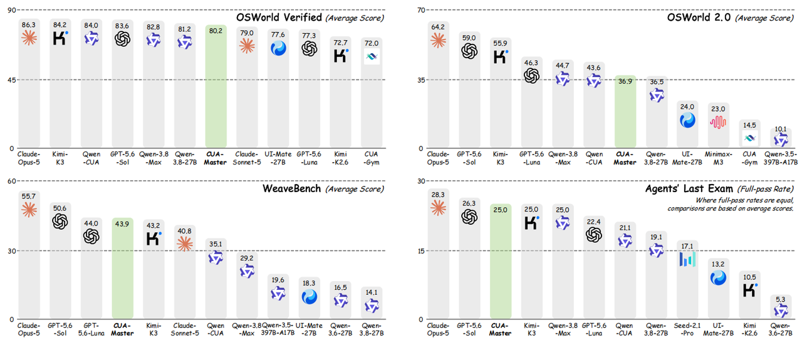
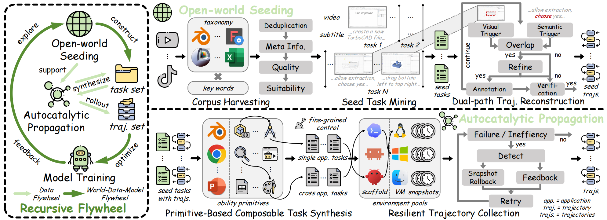

# CUAMaster

Official codebase for **CUAMaster: Scaling Computer-Use Agents through Open-World Recursive Improvement**.


[](https://arxiv.org/abs/XXXXXX)
[](https://xlyu0106.github.io/CUA-Master/)
[](https://huggingface.co/yxl66666/CUAMaster-27B)
[](https://github.com/xlyu0106/CUA-Master)


<p align="center">
  
</p>


## Installation

```bash
pip install -e ".[seeding,annotator,collection,dev]"
cp .env.example .env    # fill in your API keys and sandbox service endpoints
```

## Overview

1. **Corpus harvesting** — `cuamaster.seeding.harvesting` retrieves instructional videos with taxonomy-driven compositional queries (`configs/seeding/taxonomy.yaml`, 8 domains / 36 subdomains / 650+ apps), then deduplicates and filters them.
2. **Suitability scoring** — `cuamaster.seeding.scoring` transcribes audio and scores CUA suitability with an annotator model (`prompts/video_suitability_scoring.txt`).
3. **Seed task mining & dual-path reconstruction** — `cuamaster.seeding.reconstruction` segments tasks and reconstructs trajectories by intersecting semantic triggers (transcript clauses) with visual triggers (frame-change detection) into a boundary lattice, then rechecks, annotates, and verifies them.
4. **Primitive extraction & task synthesis** — `cuamaster.propagation` abstracts seed tasks into reusable ability primitives and composes them into verifiable tasks under explicit complexity control (K primitives, N applications).
5. **Resilient trajectory collection** — `cuamaster.collection` rolls out tasks in sandboxed environments with feedback-guided snapshot-rollback retries. The sandbox manager is exposed as a provider interface (`cuamaster/collection/providers/`); plug in your own VM/sandbox orchestration backend.
6. **Model training** — `scripts/prepare_*_sft.py` convert verified trajectories into SFT datasets (ms-swift format); RL uses the task-specific verifiers for outcome-based rewards.


<p align="center">
  
</p>

## Quick Start

Every CLI below supports `--help` for the full option list. Installed console
commands (`cuamaster-*`) are available after `pip install -e .`; the
`python -m` forms work the same way.

### 1. Open-world seeding (videos → verified seed trajectories)

```bash
# Search for candidate instructional videos (metadata only, no download).
python -m cuamaster.seeding.harvesting.search_cli \
    --config configs/seeding/sources.example.yaml

# Download the selected videos (metadata JSONL in, mp4 files out).
python -m cuamaster.seeding.harvesting.download \
    --inputs data/search_results/*.jsonl --out-dir data/videos

# Transcribe audio with faster-whisper (timestamped segments JSON).
python -m cuamaster.seeding.transcription.transcribe \
    --input-dir data/videos --output-dir data/transcripts

# Score each video 0–5 for CUA suitability (prompts/video_suitability_scoring.txt).
python -m cuamaster.seeding.scoring.score \
    --input-dir data/videos --transcript-dir data/transcripts \
    --output-dir data/scores --backend openai --summarize

# Dual-path trajectory reconstruction: seed task mining, boundary lattice,
# action annotation, and trajectory verification in one pass.
# --input is the score-filtered video metadata JSONL (see cuamaster.seeding.cleaning).
python -m cuamaster.seeding.reconstruction.construct \
    --config configs/seeding/reconstruction.example.yaml \
    --input data/filtered_videos.jsonl --output-dir data/seed_tasks
```

`cuamaster.seeding.cleaning` (dedup / noise filtering / merging) and
`cuamaster.seeding.rewriting` (action rewriting) expose `python -m` CLIs in the
same style for post-processing reconstructed trajectories.

### 2. Autocatalytic propagation (seed tasks → synthesized verifiable tasks)

```bash
# Extract ability primitives, compose new tasks (K primitives × N apps),
# build task-level verifiers, and compile to executable benchmark format.
cuamaster-synthesize --config configs/propagation/example.yaml \
    --output-dir data/generated_tasks
```

### 3. Trajectory collection (tasks → trajectories, snapshot-rollback retries)

```bash
# End-to-end smoke test without any VM: a mock runner that honors the
# collector's external-runner contract (see examples/mock_runner.py).
cuamaster-collect --config configs/collection/mock_command.example.json \
    --output-root data/mock_collection

# Register / inspect versioned VM images used by the collector.
cuamaster-vm-images --store vm_images list

# Inspect versioned task specifications before a run.
cuamaster-tasks data/generated_tasks --require-evaluator

# Roll out tasks over the VM profile matrix with snapshot-rollback retries.
cuamaster-collect --config configs/collection/vm_matrix.example.json \
    --output-root data/collection

# Export accepted episodes as an SFT-ready dataset.
cuamaster-dataset --collection-root data/collection --output-dir data/dataset
```

The collector talks to VMs through the `SandboxProvider` interface
(`cuamaster/collection/providers/sandbox.py`); wire in your own orchestration
via the provider registry, or use the generic command backend
(`configs/collection/command_backend.example.json`).

### 4. Training data preparation

```bash
# Convert reconstructed seed trajectories into ms-swift SFT format.
python -m scripts.prepare_cua_swift_sft \
    --cua-root data/seed_tasks --rank-paths data/scores --output-dir data/sft

# Convert collected trajectories (canonical runtime protocol) into SFT format.
python -m scripts.prepare_traj_collection_canonical_runtime_sft \
    --root data/collection --output data/sft/collection.jsonl

# Merge trajectory directories without overwriting logical duplicates.
python -m scripts.merge_cua_datasets \
    --primary data/seed_tasks --secondary data/seed_tasks_v2 --output data/merged
```

`scripts/` also provides balanced sampling (`sample_jsonl_balanced`), dataset
splitting (`split_swift_jsonl_by_image_group`), and an end-to-end
task→trajectory driver (`task_trajectory_pipeline`).

### 5. Runtime & benchmarks (library use)

```python
from cuamaster.action_space import CUAAction, validate_action
from cuamaster.runtime import CanonicalEpisodeRunner, OpenAICompatibleModel
from cuamaster.benchmarks import INTERACTION_HARNESSES  # GUI / CLI / hybrid modes

validate_action({"type": "computer.click", "args": {"x": 500, "y": 300}})  # [0,1000] coords
```


## Citation

```bibtex
@article{cuamaster,
  title={CUAMaster: Scaling Computer-Use Agents through Open-World Recursive Improvement},
  year={2026}
}
```


## Acknowledgements
We sincerely thank for the open-source code for [OpenComputer](https://github.com/echo0715/OpenComputer), [ScaleCUA](https://github.com/THUDM/SCALE-CUA) and [Weavebench](https://github.com/weavebench/WeaveBench).
